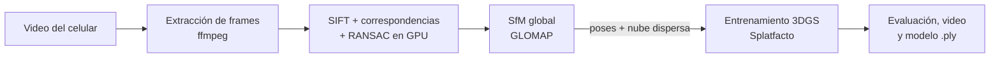
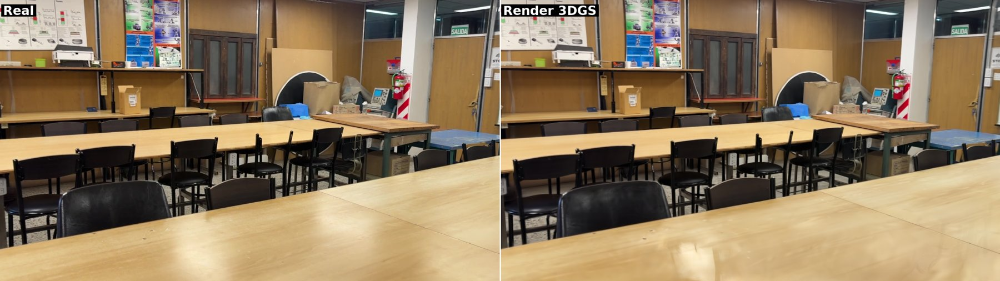
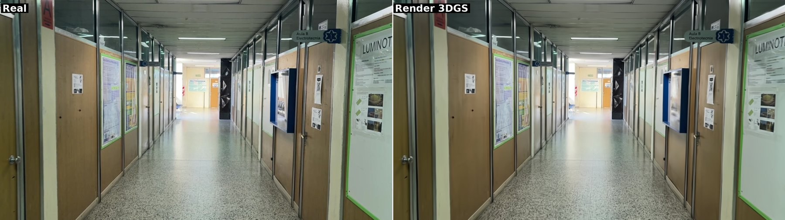
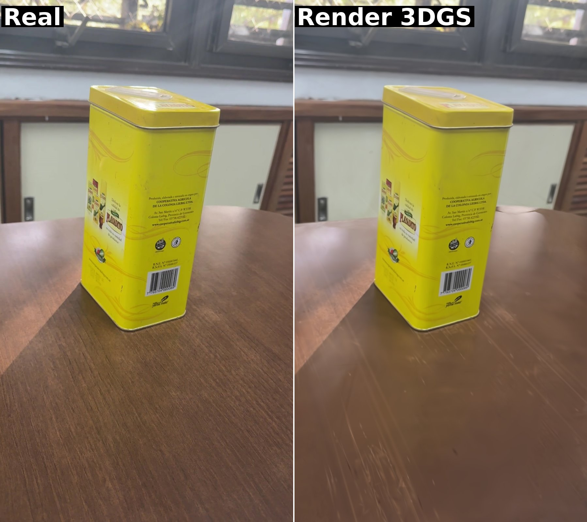
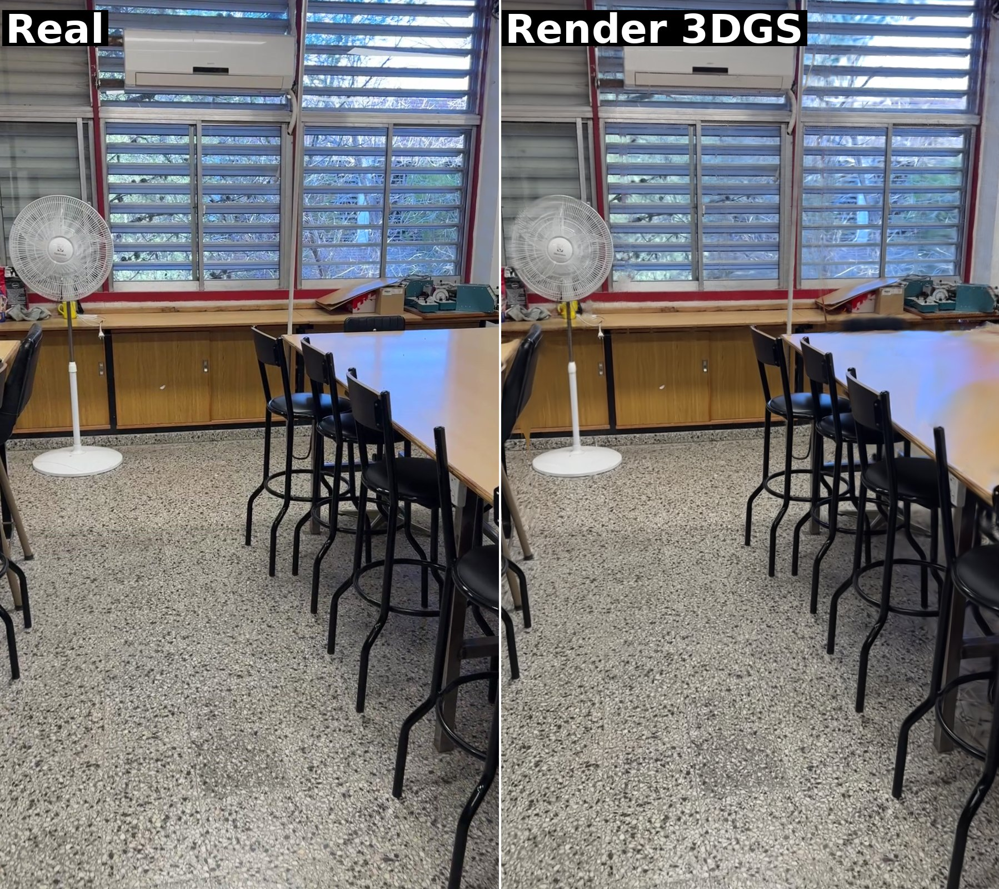
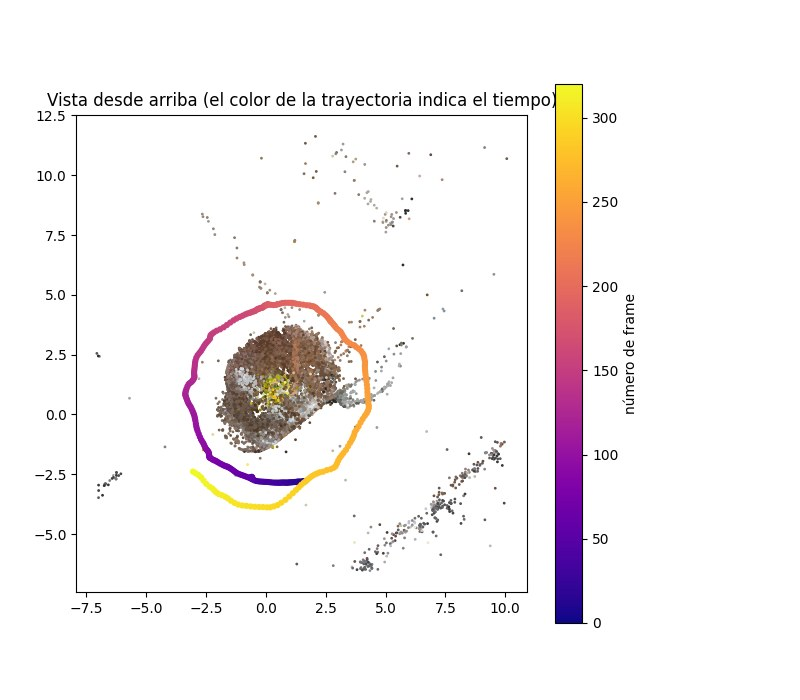
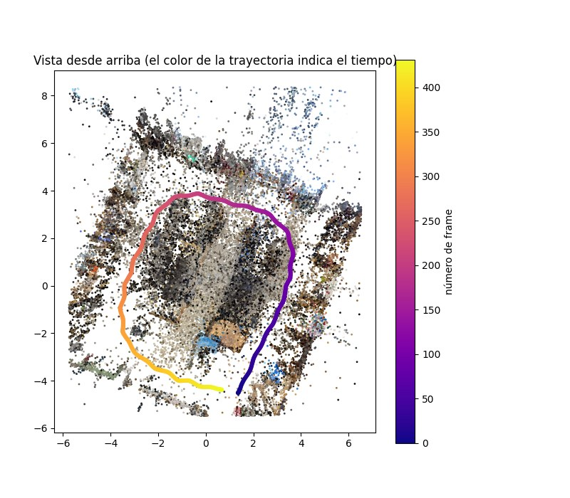
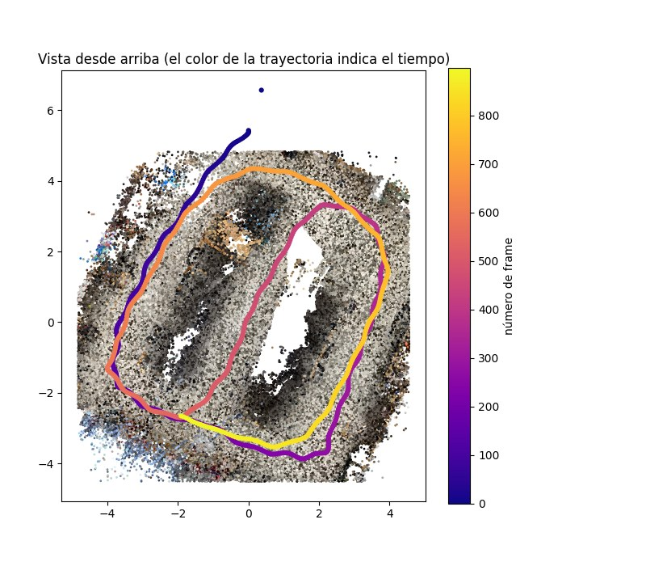
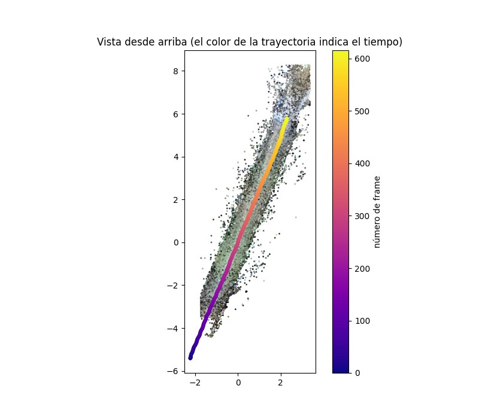

# Reconstrucción 3D de espacios mediante COLMAP y Gaussian Splatting

[](https://colab.research.google.com/github/agustinschwerdt/3DGS_Colab/blob/main/3DGS_Colab.ipynb)

Proyecto final de **Introducción a los Vehículos Inteligentes**: Ingeniería Electrónica, Facultad de Ingeniería, Universidad Nacional del Comahue.

**Autores:** Agustín Schwerdt, Andrés Goinhex

📄 **Paper:** [`Paper/paper_3DGS.pdf`](Paper/paper_3DGS.pdf)

---

## ¿De qué se trata?

A partir de **un único video filmado con un celular**, sin LiDAR y sin calibrar la cámara, reconstruimos en 3D escenas reales de la facultad: un objeto sobre una mesa, dos aulas y un pasillo. El resultado se puede recorrer virtualmente desde cualquier punto de vista.

El proyecto tiene dos etapas:

1. **Structure from Motion (SfM)**: con COLMAP estimamos desde dónde se tomó cada frame (la *pose* de la cámara) y una nube de puntos 3D de la escena. Es el problema de **mapeo y localización simultánea (SLAM)** de la materia, resuelto en forma *offline* con todo el video junto. Usa SIFT, correspondencias entre imágenes y RANSAC.
2. **3D Gaussian Splatting (3DGS)**: representamos la escena con cientos de miles de *gaussianas 3D*, pequeñas "manchas" semitransparentes con posición, forma, opacidad y color. Las entrenamos para que, al proyectarlas desde la pose de cada foto, el resultado se parezca a la foto real. Así obtenemos un modelo fotorrealista que se renderiza en tiempo real.



## Resultados

Probamos el pipeline con cuatro escenas:

| | Lata | Aula B1 | Aula B2 | Pasillo |
|---|:-:|:-:|:-:|:-:|
| Frames usados | 321 | 432 | 899 | 617 |
| Frames con pose estimada | 100 % | 100 % | 100 % | 100 % |
| Error de reproyección medio (px) | 0,52 | 0,62 | 0,36 | 0,40 |
| **PSNR (dB)** ↑ | **32,89** | 29,12 | 27,36 | 31,31 |
| **SSIM** ↑ | 0,934 | **0,942** | 0,891 | 0,934 |
| **LPIPS** ↓ | 0,246 | **0,100** | 0,125 | 0,102 |
| Gaussianas | 176 mil | 422 mil | 2,86 M | 884 mil |
| Tiempo SfM + entrenamiento (min) | 3,5 + 29,6 | 15,6 + 37,2 | 106,9 + 71,3 | 31,7 + 47,2 |

Las métricas se calculan sobre frames que **no** se usaron para entrenar (10 % del video). Como esos frames son vecinos de los de entrenamiento, los valores son algo optimistas: desde puntos de vista alejados del recorrido filmado aparecen artefactos.

**Foto real (izquierda) vs. render del modelo (derecha), en frames no usados para entrenar:**




<p align="center">
  
  
</p>

**Trayectoria de la cámara estimada por el SfM (vista desde arriba):**

<p align="center">
  
  
  
  
</p>

Los videos de recorrido renderizados están en `Resultados/<escena>/recorrido.mp4`.

## Cómo usarlo

1. Subí tu video a **Google Drive**, en *Mi unidad*.
2. Abrí el notebook con el botón **Abrir en Colab** de arriba.
3. En Colab elegí una GPU: *Entorno de ejecución → Cambiar tipo de entorno de ejecución → L4* (o A100). Necesita **Colab Pro**, porque con una T4 el entrenamiento es muy lento.
4. En la celda de **parámetros** completá:
   - `VIDEO`: ruta del video, por ejemplo `/content/drive/MyDrive/mi_video.MOV`.
   - `FRAMES_OBJETIVO`: cuántos frames usar. Con 300 alcanza para un video corto y con 600 a 900 para un aula entera.
   - `ITERACIONES`: 30000 da el resultado final y 7000 sirve para una prueba rápida.
5. *Entorno de ejecución → Ejecutar todo* y aceptá el permiso de Drive cuando lo pida.

Los resultados se copian a `MyDrive/resultados_gaussian_splatting`. El modelo `splat/splat.ply` se puede abrir en un visor web de *splats*, como [SuperSplat](https://superspl.at/editor), arrastrando el archivo.

**Tiempos aproximados con una L4:** SfM de 3 a 30 min según la escena (hasta ~1,5 h para 900 frames), y entrenamiento de 30 a 70 min. La primera vez, gsplat compila sus kernels CUDA (~10 min).

### Consejos para filmar
- Moverse **despacio**, para evitar frames movidos, y recorrer la escena desde varios ángulos y alturas.
- Para un objeto, dar vueltas alrededor. Para un ambiente, recorrer el perímetro mirando hacia el centro.
- Buena iluminación y, si se puede, exposición fija. Evitar ventanas a contraluz y reflejos.
- Las superficies sin textura (paredes lisas, piso uniforme) son las más difíciles de reconstruir.

## Estructura del repositorio

```
├── 3DGS_Colab.ipynb          Notebook completo, con las salidas de la escena Aula B2
├── Paper/
│   ├── paper_3DGS.pdf        Paper del proyecto (formato IEEE)
│   └── latex/                Fuente LaTeX y figuras del paper
└── Resultados/               Un directorio por escena: playadito (Lata), aulab1, aulab2, pasillo
    └── <escena>/
        ├── resumen.json          Todos los números del notebook
        ├── metricas.json         PSNR, SSIM y LPIPS (salida de ns-eval)
        ├── config.yml            Configuración del entrenamiento
        ├── transforms.json       Poses de cámara estimadas por el SfM
        ├── recorrido.mp4         Video renderizado del modelo
        └── *.png                 Gráficos: frames, nitidez, SfM, error, curvas, gaussianas
```

**No incluidos por tamaño** (superan el límite de 100 MB de GitHub): los videos originales (`dataset/`), los modelos `.ply` de cada escena (de 44 a 709 MB), las imágenes de comparación completas y los logs de entrenamiento.

## Herramientas

- [COLMAP 4](https://colmap.github.io) a través de `pycolmap-cuda12`: SIFT y correspondencias en GPU, y SfM global con GLOMAP.
- [Nerfstudio](https://docs.nerf.studio) (Splatfacto) y gsplat: entrenamiento y render de 3D Gaussian Splatting.
- Google Colab con GPU NVIDIA L4.

## Referencias

- Cátedra Introducción a los Vehículos Inteligentes, FaIn-UNCo: Unidad II (cámara), Unidad III (extracción de características, RANSAC) y Unidad V (localización, mapas y SLAM).
- COLMAP, documentación oficial: https://colmap.github.io
- B. Kerbl *et al.*, "3D Gaussian Splatting for Real-Time Radiance Field Rendering", *ACM TOG*, 2023: https://repo-sam.inria.fr/fungraph/3d-gaussian-splatting/
- Nerfstudio, documentación oficial: https://docs.nerf.studio
